# Art review evidence for issue 138

These browser screenshots document the three backdrop SVGs added in source commit [`d56b03f`](https://github.com/Sameeplad/Lighthouse-Narrative/commit/d56b03f). Each SVG contains no text. Measured source SVG sizes are basin 2,330 bytes, berths 2,028 bytes, and market 2,432 bytes. Their measured centroids are basin (290.27, 84.14), berths (272.32, 84.51), and market (294.08, 101.57).

## Browser captures

The 390 captures show narrow mobile layouts; the 1200 captures show the wide browser viewport. The rendered app content is capped at 560px by its actual CSS, so a 1200px viewport does not expand the app beyond that width. Dark and light captures use the browser's actual theme-aware mask with 40% opacity. These files are copied directly from the browser captures without pixel processing. The screenshots are review evidence, not shipped art assets.

### Basin

| Viewport | Dark | Light |
|---|---|---|
| 390 | 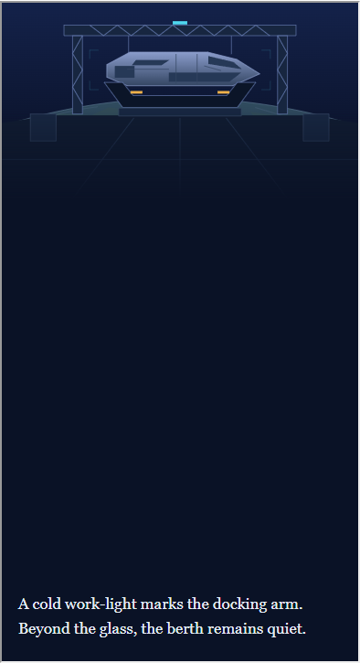 | 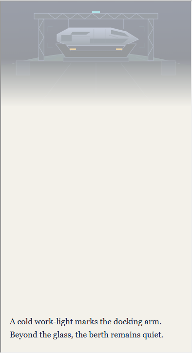 |
| 1200 | 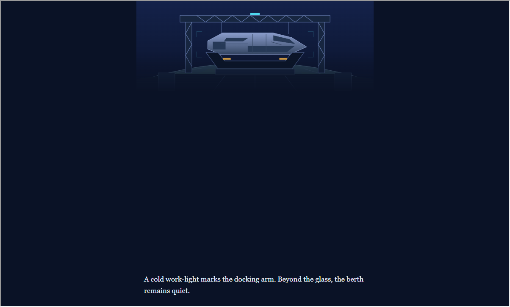 | 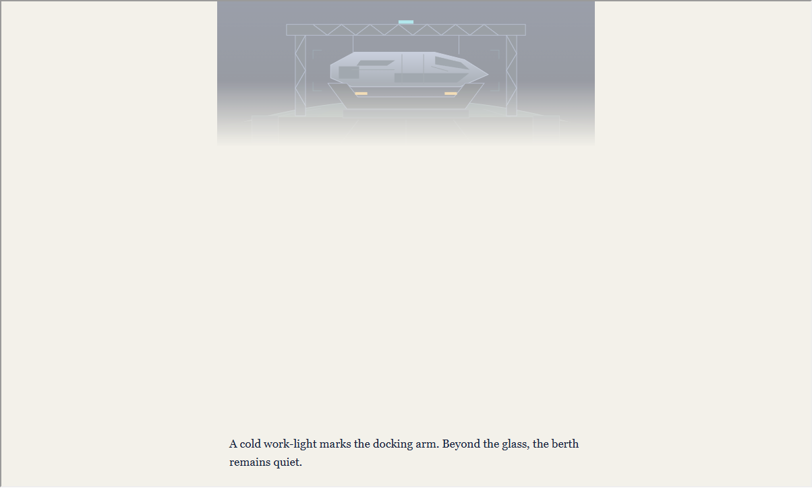 |

### Berths

| Viewport | Dark | Light |
|---|---|---|
| 390 | 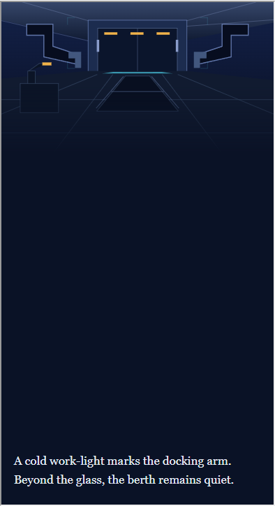 | 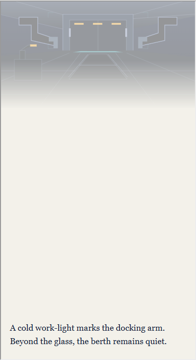 |
| 1200 | 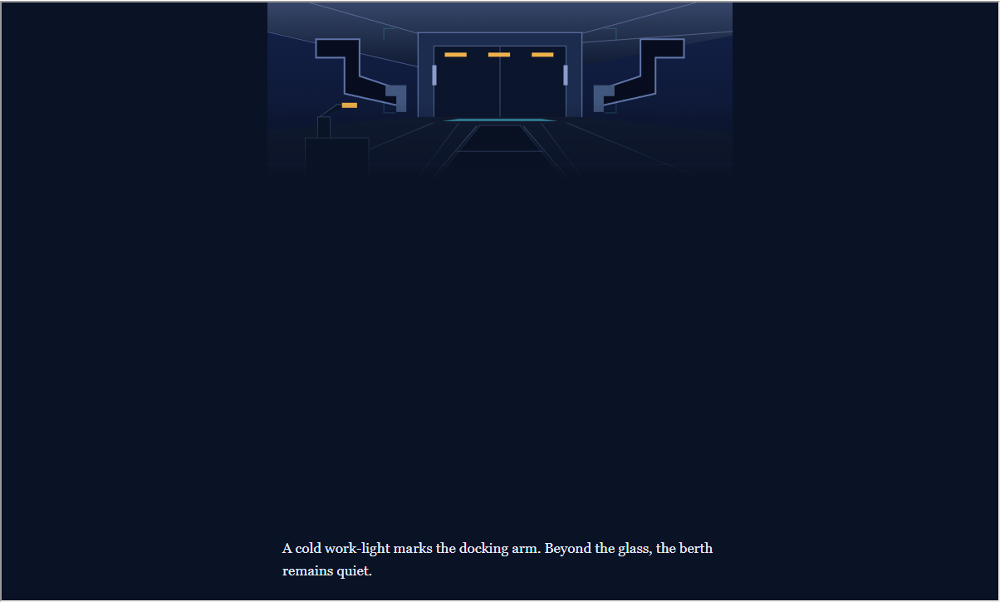 | 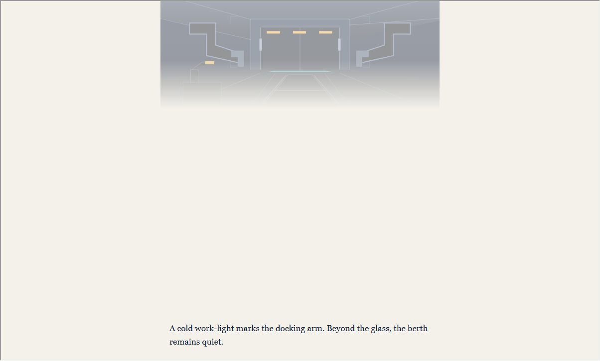 |

### Market

| Viewport | Dark | Light |
|---|---|---|
| 390 | 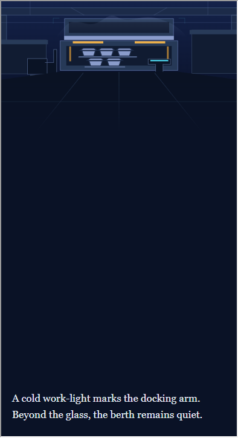 | 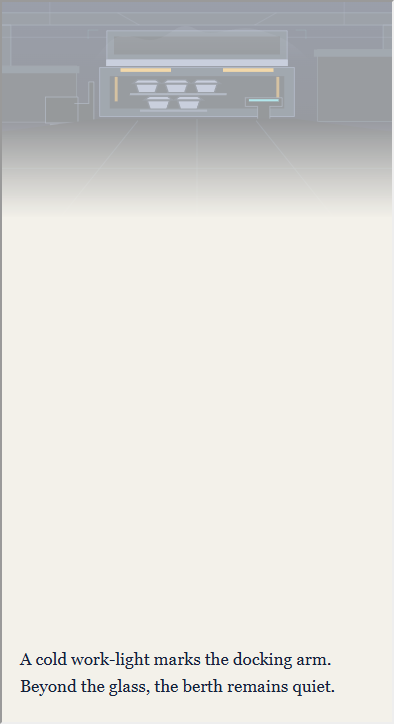 |
| 1200 | 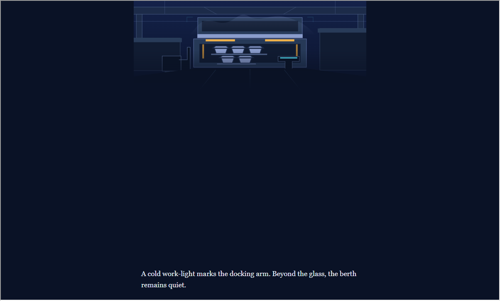 | 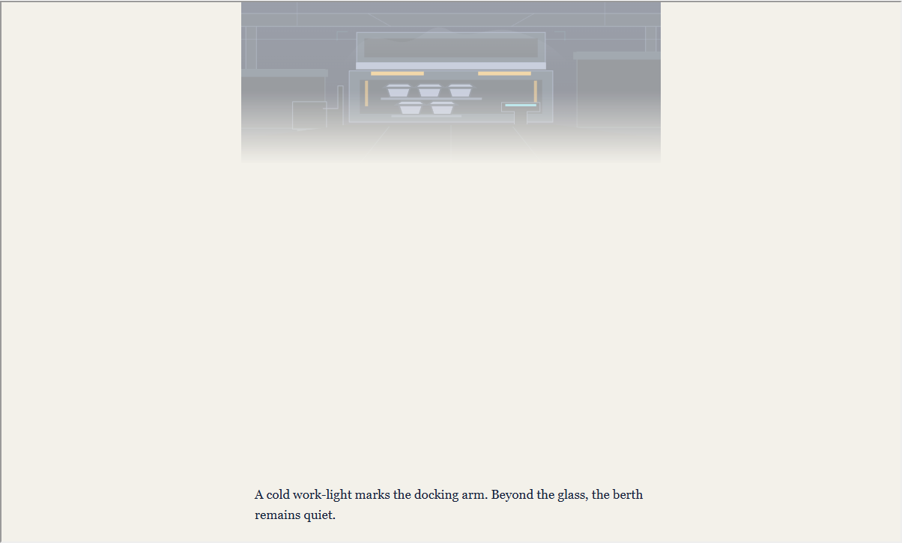 |

### Contact sheet

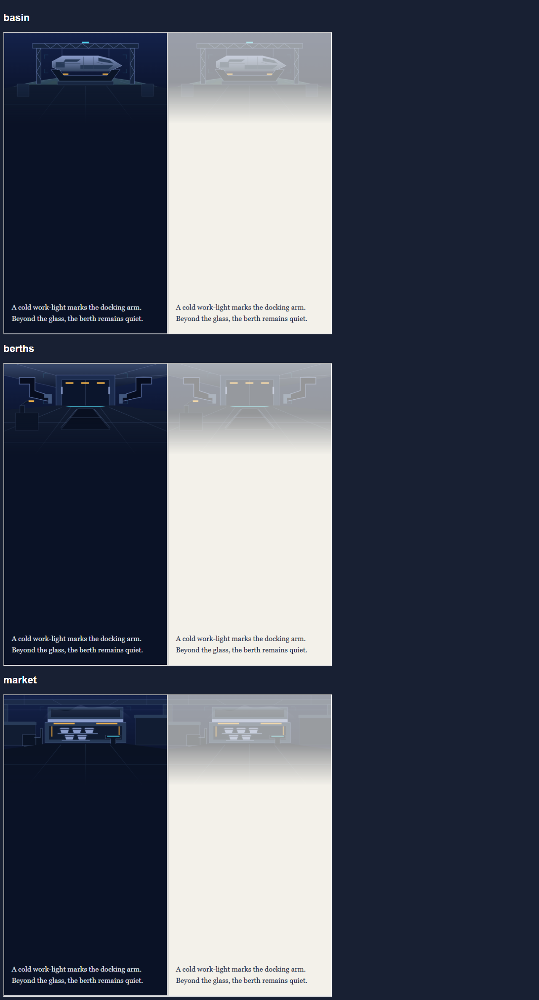

## Review notes

Self-scores: berths 9/10, market 8/10, basin 9/10. An independent Claude Sonnet 5.5 visual review of the contact sheet, wide captures, and stress cases approved the set and scored berths 10/10, market 9/10, and basin 9/10.

These scores record visual review only. Owner review remains pending, and the full art lint still fails on the existing prefix and focal-point checks. The newly added files pass those checks.
