# UI polish review evidence

Evidence only; this branch is not intended for merge. The game changes remain in PRs #203, #204 and #205.

Baseline: main fb2b7ed3a2d285a4dea153f77ced413627fe1012. Layout-only captures: PR #203 tree 1edf39328329adbb02e70071c1fa08b6dfd08239. Final combined captures: local review 51407613abf24f1818bdcc3c258a9cff99d3acb5, tree 0050c8a8e1cedd97f1e73c70eaa230198f584003, consisting of PR #203 head 815a3a5, revised PR #204 head b624c5a (identical to local 8c74258 tree), and PR #205 head a4f74c7. PR #206 is excluded.

## Tall layout before/after, unchanged artwork

| Theme | Before | Layout only |
|---|---|---|
| Dark | 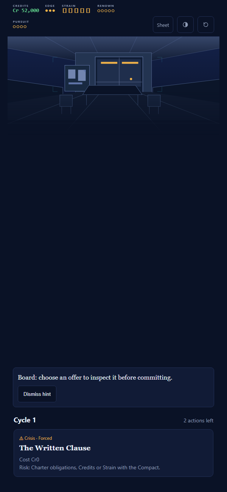 | 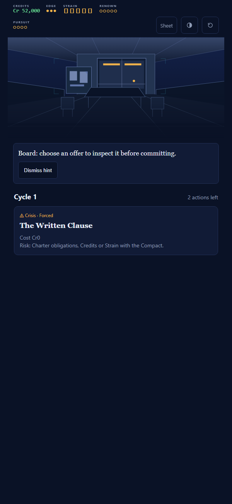 |
| Light | 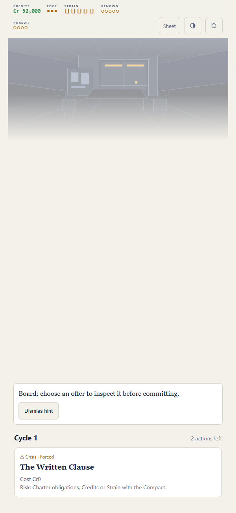 | 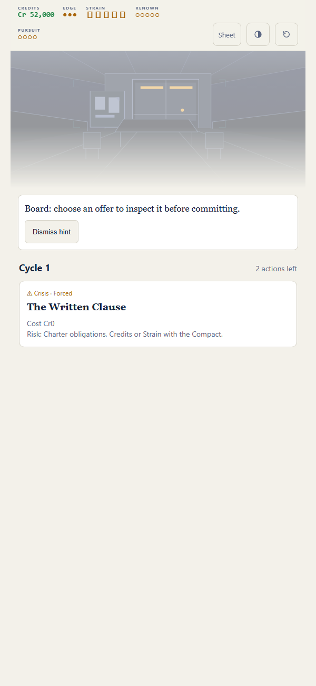 |

## Final phone comparison

| Baseline light | Final light | Final dark |
|---|---|---|
| 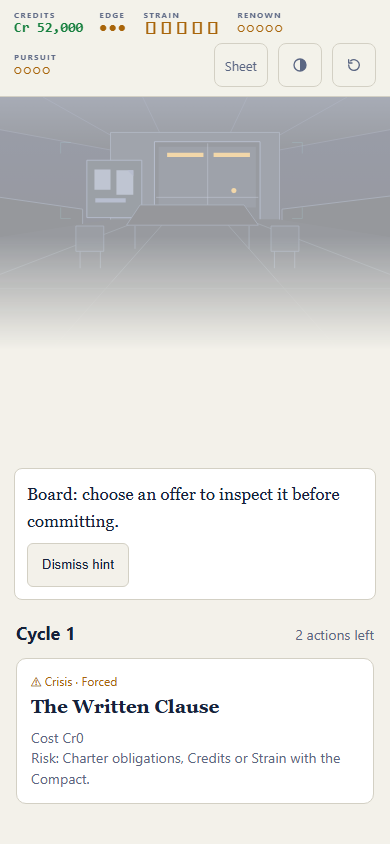 | 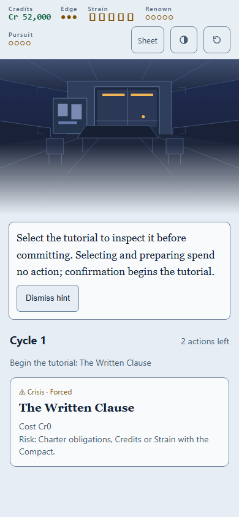 | 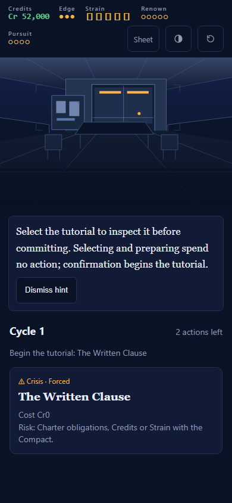 |

## Final desktop comparison

| Baseline light | Final light | Final dark |
|---|---|---|
| 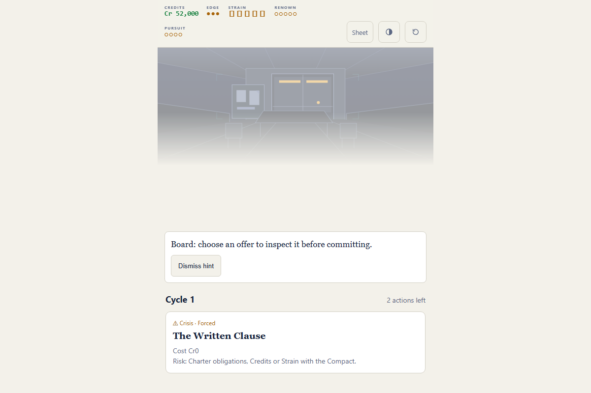 | 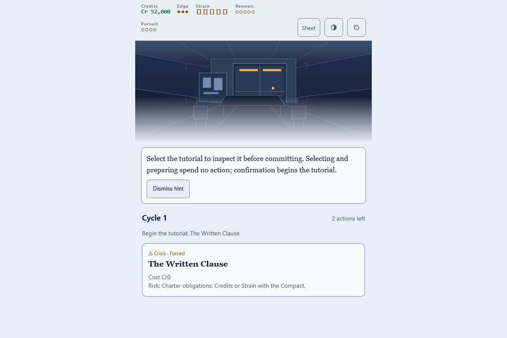 | 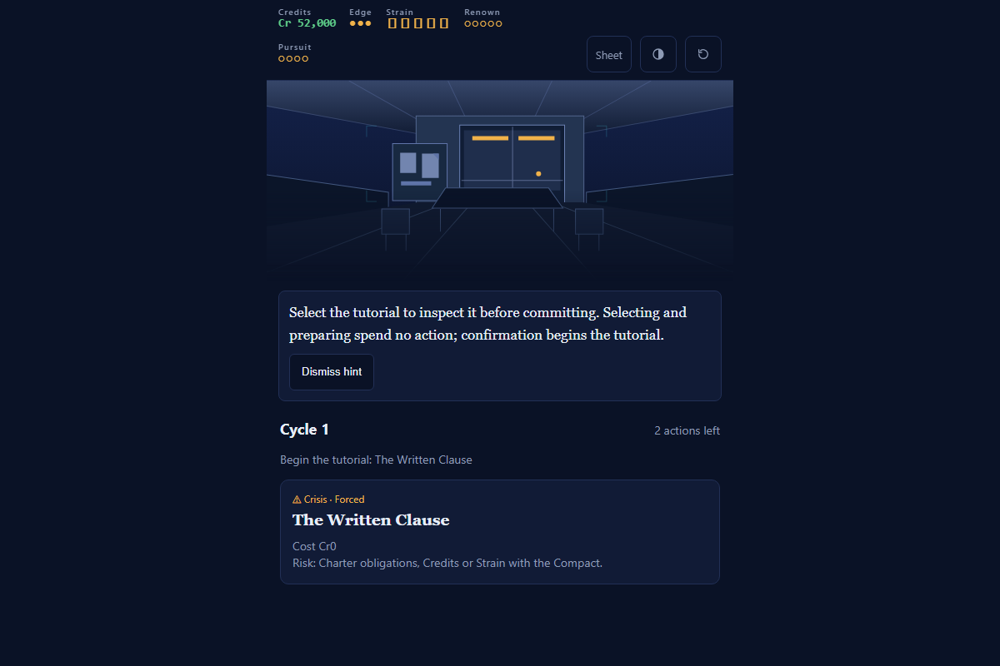 |

## Narrow phone

| Light | Dark |
|---|---|
| 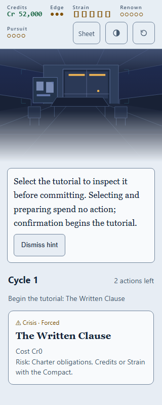 | 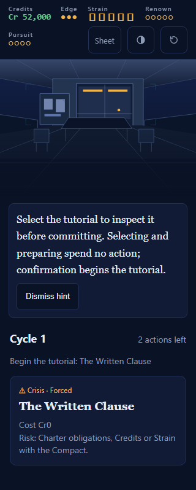 |

npm ci and npm run check: 613 tests and production build pass on the final combined tree. Browser captures use reduced motion under the actual artwork mask; opacity is verified at 0.94 light and 1 dark after paint. All four widths in both themes: empty Feed height 0, no horizontal overflow; tutorial inspection and cancellation preserve resources/actions; offer accessible name includes its visible layer/title/cost/risk; keyboard Sheet open/focus/escape pass; explicit theme selection persists over reload. A separate 320 px enlarged-body-text check also found no horizontal overflow. This is targeted browser verification, not a screen-reader or full accessibility audit.
